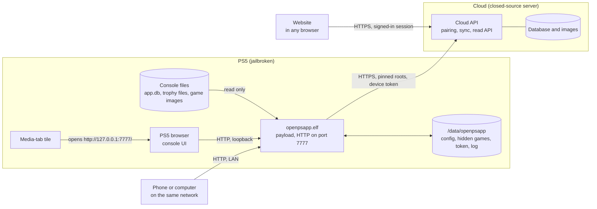
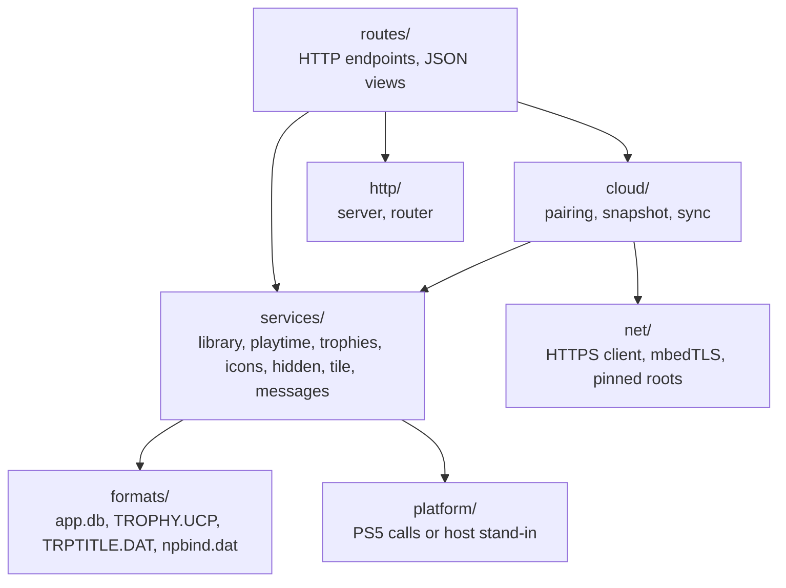
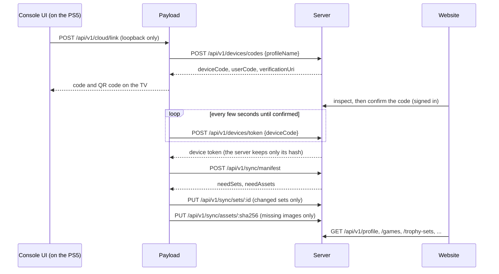
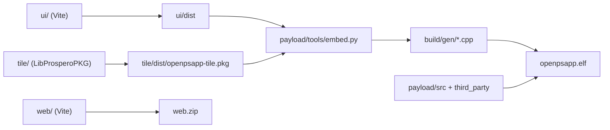

# Architecture

OpenPSApp has three running pieces: the **payload** on the PS5, the **console UI** it serves, and an optional **cloud** made of a closed-source server and the **website**. This page shows how they talk, where the trust boundaries are, and how data flows. Each area's README has the details.

## Overview

| Piece       | Where                    | What it does                                                                                                          |
| ----------- | ------------------------ | --------------------------------------------------------------------------------------------------------------------- |
| Payload     | `payload/`               | Reads the console's files, serves a JSON API and the embedded UI on port 7777, installs the tile, syncs to the cloud. |
| Console UI  | `ui/`                    | React app built for the PS5 browser (Safari 13.1), embedded in the ELF, hash-routed.                                  |
| Tile        | `tile/`                  | An app-less PKG whose only job is to open `http://127.0.0.1:7777/` from the Media tab. Embedded in the ELF.           |
| Website     | `web/`                   | React app that reads the synced profile from the server. Built here, served by the server from a release's `web.zip`. |
| Server      | private repository       | Pairing, sync and the read API for the website. Described publicly by `contract/` and `SYNC.md`.                      |
| `contract/` | `@openpsapp/contract`    | TypeScript types for every message between the console, the server and the clients (MIT). The server copies it.        |
| `core/`     | `@openpsapp/core`        | Pure logic shared by `ui/` and `web/`: formatting, dates, progress, trophy sorting and masking, pairing codes.          |

## The payload

The payload is one C++20 process with three kinds of threads:

- the **accept loop**, which hands each connection to a worker (at most 32 at once; more get `503 busy`);
- **request workers**, each with a 10 s deadline to receive the request;
- the **cloud thread**, started only when `server` is set, which wakes every 2 seconds to poll a pending pairing, revoke old tokens and sync.

Inside, the code is layered:

`services/library` joins playtime, trophy sets and images into one snapshot of the signed-in profile and caches it for 30 seconds. Every read endpoint and every cloud sync uses that snapshot. `platform/` has two implementations: `ps5.cpp` for the console and `host.cpp`, which reads a fake console filesystem so the same code runs in tests and in `make host-run`.

## Data flow

### On the console

1. The payload reads `app.db` (playtime, opened read-only), the trophy files and the game images from the console's filesystem.
2. `services/library` builds the snapshot; `routes/` turns it into JSON under `/api/v1`.
3. The console UI fetches that JSON and renders it. Game and trophy images come from `/api/v1/icons/:id`, served straight from the console files.
4. The only things the payload writes are in `/data/openpsapp`: its settings, the hidden-games list, the cloud token, a cache of image hashes and the log. It also installs the tile once through the console's package installer.

### To the cloud

The console syncs on start, right after linking, every 15 minutes, within about a minute after a change, and on **Sync now**. Each sync sends a summary first, so only changed trophy sets and missing images travel. [`SYNC.md`](SYNC.md) lists every field.

The server answers the website with the same read API shapes the payload serves (`contract/api.ts`), so `core/` and the screens work the same on both sides.

## Trust boundaries

| Boundary                       | Threat                                                     | Protection                                                                                                                                                                                                                  |
| ------------------------------ | ---------------------------------------------------------- | --------------------------------------------------------------------------------------------------------------------------------------------------------------------------------------------------------------------------- |
| Console files → payload        | A bug changes console data                                 | Read-only access (`app.db` opened read-only); writes only under `/data/openpsapp`; `test_readonly` checks that no route writes console data.                                                                               |
| LAN → payload (port 7777)      | Other devices read or change things                        | Reads are open to the LAN by design. `POST` routes need the `X-OpenPSApp: 1` header. Cloud actions also need a loopback peer and a `Host` of `127.0.0.1:<port>` or `localhost:<port>`.                                    |
| Other websites → payload       | CSRF and DNS rebinding from a page open in a browser       | No CORS headers, so a page on another origin cannot send `X-OpenPSApp`; the `Host` check defeats DNS rebinding for cloud actions; the pairing code is never shown to non-loopback clients.                                 |
| Slow or abusive clients        | Exhausting the payload                                     | 16 KiB of headers, 64 KiB of body, a 10 s request deadline per connection, 32 workers.                                                                                                                                      |
| Payload → server (internet)    | Interception, a fake server                                | HTTPS only, certificate and host name checked, only ISRG Root X1 and X2 trusted, responses capped at 8 MiB.                                                                                                                 |
| Device token                   | Theft, reuse                                               | 256-bit random, stored hashed on the server, write-only (it cannot read the account), revocable from the website or the console. On the console it is stored unencrypted in `cloud.json` (mode 0600).                      |
| Pairing                        | Linking someone else's console, phishing links             | Codes expire after 10 minutes and work once; the confirmation page shows the profile name and the console it replaces, and warns to confirm only a code visible on the TV.                                                 |
| Website ↔ server               | Account takeover, XSS                                      | Sign-in through Clerk; the server sends a Content Security Policy and security headers (server side, not in this repository).                                                                                              |
| Server operator                | Reading users' data                                        | **Not protected.** The data is encrypted in transit, not end to end; the operator can technically read it.                                                                                                                 |

Out of scope: anything that already runs code on the jailbroken console can read all of OpenPSApp's files, including the token.

## Builds

- `embed.py` turns `ui/dist` and the tile PKG into C++ byte arrays (sorted, gzip with a zero timestamp). A missing UI becomes a placeholder page and a missing PKG skips the tile install.
- The version comes from `git describe --tags`; outside a git checkout it is `dev`.
- The release workflow builds the ELF twice and compares the hashes, packs `web.zip` reproducibly, and attests every artifact. See [CONTRIBUTING.md](CONTRIBUTING.md#releasing).

## Shared code

- `contract/` holds types only. The payload's JSON, the server's routes and both clients follow it. It is MIT so the closed-source server can copy it.
- `core/` holds logic only, with tests. Both `ui/` and `web/` import it as `@openpsapp/core`; nothing in it touches the DOM or the network.
