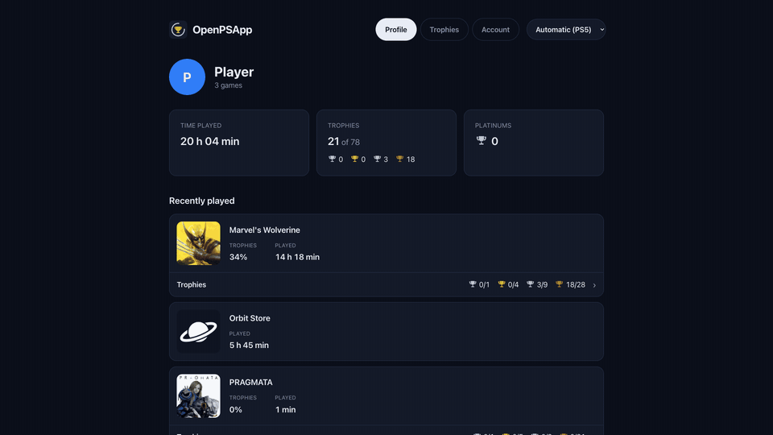
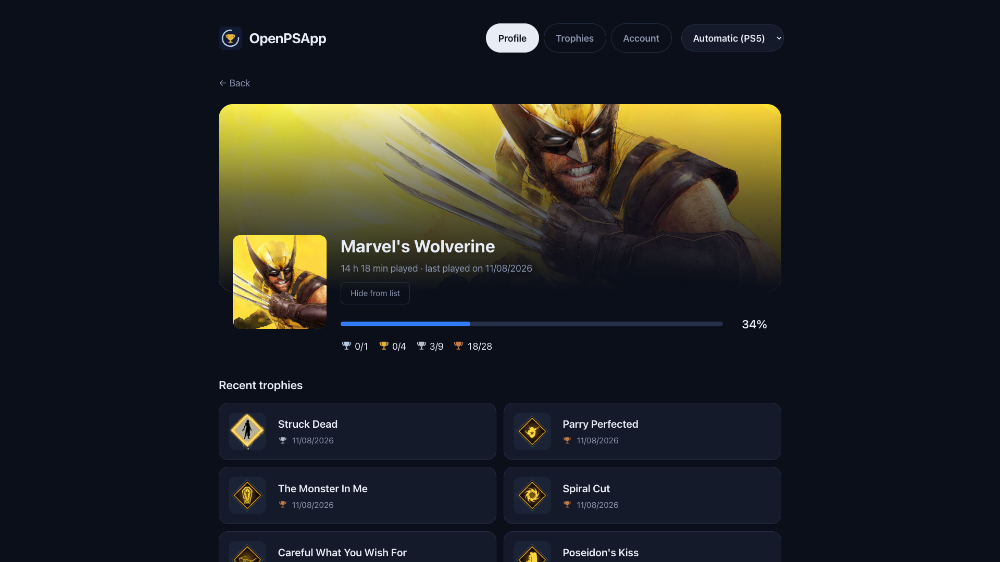
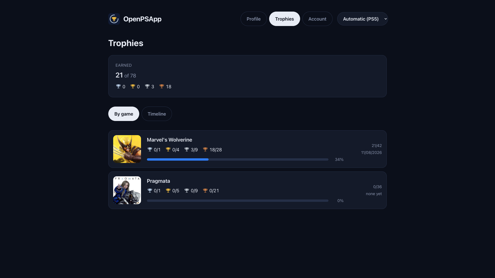
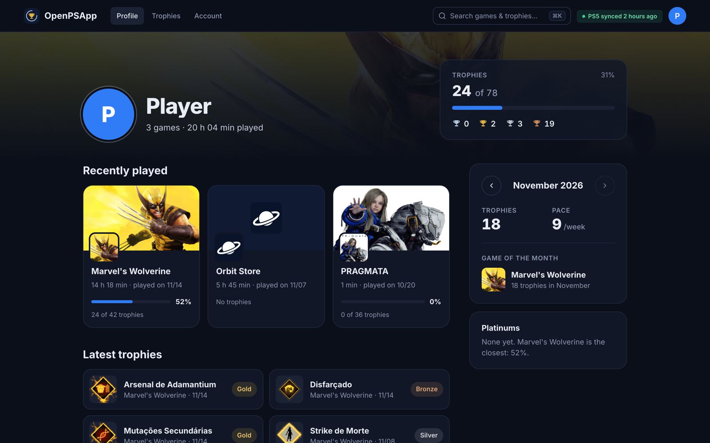
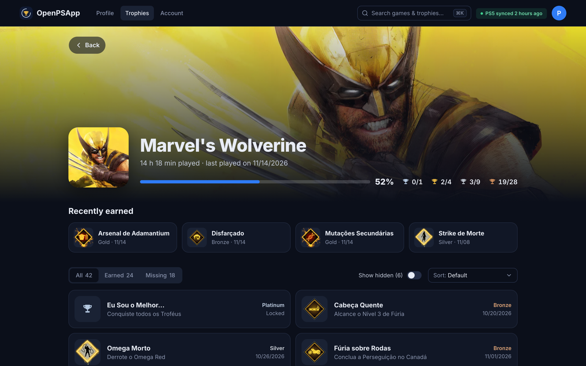
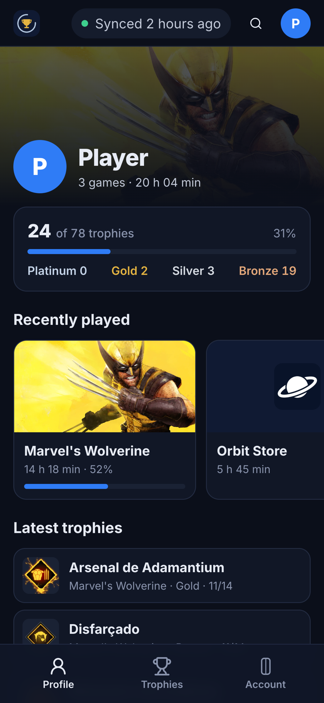
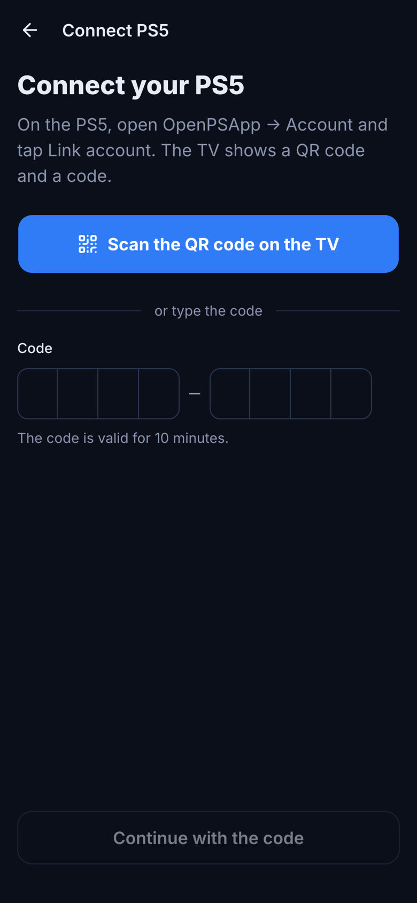

<p align="center"></p>

<h1 align="center">OpenPSApp</h1>

<p align="center">Your PS5 playtime and trophies, on the console and anywhere else.</p>

<p align="center">
  <a href="https://github.com/marcelorsdd/OpenPSApp/actions/workflows/ci.yml"></a>
  <a href="https://github.com/marcelorsdd/OpenPSApp/actions/workflows/codeql.yml"></a>
  <a href="https://scorecard.dev/viewer/?uri=github.com/marcelorsdd/OpenPSApp"></a>
  <a href="https://www.bestpractices.dev/projects/16706"></a>
  <a href="https://github.com/marcelorsdd/OpenPSApp/releases/latest"></a>
  <a href="LICENSE"></a>
  <a href="contract/LICENSE"></a>
  <a href=".nvmrc"></a>
</p>

<p align="center"></p>

OpenPSApp is homebrew for a jailbroken PS5. A jailbroken console has no PlayStation App, so OpenPSApp brings the parts you miss back to the console itself: playtime per game, trophies (hidden ones included), a monthly recap and a trophy timeline. It works offline. If you want, it can also sync to a website, so you can follow your profile from your phone even with the PS5 off.

## Contents

- [What it does](#what-it-does)
- [Screenshots](#screenshots)
- [Requirements](#requirements)
- [Install](#install)
- [First launch](#first-launch)
- [Using it](#using-it)
- [The website (optional)](#the-website-optional)
- [Privacy](#privacy)
- [Settings](#settings)
- [FAQ](#faq)
- [Troubleshooting](#troubleshooting)
- [Contributing](#contributing)
- [License](#license)

## What it does

- **Profile:** number of games, total time played, trophies and platinums, recently played games and a monthly recap.
- **Game pages:** playtime, last played date, recent trophies and the full trophy list.
- **Trophies:** by game or as a timeline. Filter and sort them, and reveal hidden trophies one at a time.
- **Hide games**, such as homebrew, from the lists and totals.
- **Three languages:** English, Portuguese (Brazil) and Spanish. It follows the console language by default.
- **Your phone works too:** open it from any phone or computer on the same network.
- **Optional website:** link the console to an account and see the same profile anywhere.
- **Read-only on your data:** it reads the console's playtime and trophy files and never changes them. It writes only to its own folder, `/data/openpsapp`, and installs one Media-tab tile.

## Screenshots

### On the console

<p align="center"></p>

<table>
  <tr>
    <td align="center"><br>Game page</td>
    <td align="center"><br>Trophies</td>
  </tr>
</table>

### On the website

<table>
  <tr>
    <td align="center"><br>Profile</td>
    <td align="center"><br>Game page</td>
  </tr>
</table>

<table>
  <tr>
    <td align="center"><br>Profile on a phone</td>
    <td align="center"><br>Linking a console</td>
  </tr>
</table>

## Requirements

- A jailbroken PS5 that can load ELF payloads built with [ps5-payload-sdk](https://github.com/ps5-payload-dev/sdk), for example through elfldr (port 9021) or Prospero Manager. Which firmware versions work depends on your jailbreak, not on OpenPSApp.
- To open it from a phone or computer: that device on the same network as the PS5.
- For the website: internet on the PS5 and an account on the website. See [The website](#the-website-optional).

## Install

1. Download `openpsapp.elf` from the [latest release](https://github.com/marcelorsdd/OpenPSApp/releases/latest).
2. Send it to your payload loader.
   - **elfldr** (listening on port 9021), from a computer on the same network:
     ```sh
     socat -t 99999999 - TCP:192.168.1.50:9021 < openpsapp.elf
     ```
     Use your console's IP address instead of `192.168.1.50`.
   - **Prospero Manager:** add `openpsapp.elf` to its payload library from its web page, then launch it.
3. Wait for the notification **OpenPSApp running on port 7777**.

### Start it with the console

The jailbreak, and OpenPSApp with it, stops when the console restarts. If your loader can autoload payloads (Prospero Manager's autoloader, for example), add `openpsapp.elf` to it so OpenPSApp starts every time you run the jailbreak.

### Check the download (optional)

Newer releases include a `SHA256SUMS` file and a signed build provenance attestation:

```sh
sha256sum -c SHA256SUMS --ignore-missing
gh attestation verify openpsapp.elf --repo marcelorsdd/OpenPSApp
```

## First launch

1. The first time it runs, OpenPSApp adds a tile to the **Media** tab of the home screen and shows **OpenPSApp added to the Media tab**.
2. Open the tile. The app opens in the PS5 browser, at `http://127.0.0.1:7777/`.

The tile only works while OpenPSApp is running. After a restart, load the ELF again before you open it.

Notifications follow the console language: English, Portuguese or Spanish (other languages get English). If you load OpenPSApp twice, the second copy shows **OpenPSApp is already running** and exits.

## Using it

The app has three tabs at the top: **Profile**, **Trophies** and **Account**, plus a language picker.

### Profile

Your games, time played, trophies and platinums. Below them: **Recently played** and the **Monthly recap**, with the trophies of the month, the game of the month and your pace. Use the arrows to move between months.

### Game page

Select a game to see how long you played it, when you last played it, its recent trophies and the full trophy list.

### Trophies

- The **Trophies** tab shows every game with trophies (**By game**) or every trophy you earned, newest first (**Timeline**).
- On a game's trophy list, filter by **All**, **Earned** or **Not earned**, and sort by **Default**, **Date earned** or **Trophy type**. The app remembers your choice.
- Hidden trophies you have not earned show as **Hidden trophy**. Press **Reveal** to see one, or **Show hidden** to see all of them.

### Hiding games

On a game page, press **Hide from list** to take a game (homebrew, for example) out of the lists and totals. **Show in list** brings it back. On the profile, **hidden games · show** lists the hidden games again. The list is saved on the console, in `/data/openpsapp/hidden.json`.

### Language

The app follows the console language. To pick another one, use the language picker at the top. The choice is saved in the browser you use, so the PS5 and your phone can use different languages.

### From a phone or computer

Open `http://<console-ip>:7777` in any browser on the same network, for example `http://192.168.1.50:7777`. You can find the console's IP address in **Settings → Network → Connection Status → View Connection Status**.

Everything works the same, except the website account actions (**Link account**, **Unlink** and **Sync now**): for safety, those only work on the PS5 itself.

## The website (optional)

The website shows the same profile, trophies and game pages on any phone or computer, even when the PS5 is off. It also has a search, and you can add it to your phone's home screen. The console uploads your data to the OpenPSApp server, and the website reads it from there.

The console app and the website are open source and live in this repository. The server is run by the project and is closed source; [`SYNC.md`](SYNC.md) and [`contract/`](contract/) describe exactly what it receives.

### Turn the cloud on

Cloud features are off until OpenPSApp knows the server's address. Set it in the `server` key of `/data/openpsapp/config.json` (see [Settings](#settings)), then restart OpenPSApp. While it is empty, the **Account** tab says **The cloud is not set up on this console.**

> [!NOTE]
> The official server address is not published yet. When it is, it will be listed here and in the release notes.

### Link your console

1. On the PS5, open OpenPSApp, go to **Account** and press **Link account**.
2. The TV shows a code such as `K7Q4-PX2A`, a QR code and the website address. The code is valid for 10 minutes.
3. On your phone or computer, open the website and sign in. Then either:
   - press **Scan the QR code on the TV** and point the camera at it, or
   - type the code and press **Continue**.
4. Check the confirmation page. It shows the profile name, what the console will send and, if your account already has a console, which one it replaces. Only confirm if the same code is on your TV right now. Press **Connect**.
5. The console finishes linking in a few seconds and sends your games and trophies.

An account has one console. Linking another PS5 replaces the current one.

### When it syncs

The console sends your data when OpenPSApp starts, every 15 minutes, and within about a minute after something changes, such as a new trophy. **Account → Sync now** on the PS5 sends it right away.

### Unlink and delete your data

- **On the PS5:** **Account → Unlink**. The console forgets its token at once and asks the server to revoke it.
- **On the website:** **Account → Disconnect**. Check **Also delete the account data** to also delete the games, playtime and trophies the console sent; without it, they stay on your account.
- **Delete everything:** on the website, **Account → Delete account and data**, then **Delete account**. This deletes your account, the linked console, everything it sent and your sign-in. Game and trophy images are shared between accounts, so they stay on the server.

To remove OpenPSApp from the console itself, see [How do I uninstall it?](#how-do-i-uninstall-it)

## Privacy

- **On the console:** OpenPSApp reads the console's playtime database, trophy files and game images. It writes only to `/data/openpsapp`. It never talks to Sony or PSN.
- **On your network:** anyone on the same network can open `http://<console-ip>:7777`. There is no password, so they can see your profile name, games, playtime and trophies, and hide or show games. Linking and unlinking the website only work on the PS5 itself. Other devices can see whether the console is linked, the profile name, the last sync time and error, and how long a pairing code has left, but never the code.
- **Nothing leaves the console** until you set a server address and press **Link account**.
- **When linked,** the console sends your profile name, console language, games, playtime, trophies and game and trophy images to the OpenPSApp server over HTTPS. Games you hid are sent too, marked as hidden, and so are the names of hidden trophies.
- **No end-to-end encryption.** HTTPS encrypts the data on the way to the server, but the server stores it in a form it can read. Whoever runs the server can technically read your synced data.
- **Never sent:** console identifiers (serial, MAC address, console id) and PlayStation Network account ids.
- **The console's token** is kept unencrypted in `/data/openpsapp/cloud.json`. Anything that can read the console's files can read it.
- **Deleting:** you can unlink or delete your account at any time. Shared game and trophy images stay on the server.

[`SYNC.md`](SYNC.md) lists exactly what is sent, when, and what is never sent.

## Settings

Settings live in `/data/openpsapp/config.json`, created on the first run. Edit it with your loader's FTP server or file manager, then restart OpenPSApp.

| Key        | Default  | What it does                                                                                                                                      |
| ---------- | -------- | ------------------------------------------------------------------------------------------------------------------------------------------------- |
| `port`     | `7777`   | The port of the app. The Media-tab tile always opens port 7777, so keep the default unless you open the app by its address.                       |
| `language` | `"auto"` | `"auto"` follows the console language. A tag such as `"pt-BR"` sets the language of notifications, trophy texts and the app's default language.   |
| `debug`    | `false`  | Turns on diagnostic endpoints. They expose console files and console ids to your network, so leave it off unless you are debugging.               |
| `server`   | `""`     | The HTTPS address of the OpenPSApp server. Empty keeps the cloud off.                                                                             |

Other files in the same folder: `openpsapp.log` (the log), `hidden.json` (hidden games), `cloud.json` (the website link) and `asset-hashes.json` (a cache of image hashes).

## FAQ

### Does it work offline?

Yes. Everything on the console works without internet. Only the website needs it.

### Can it damage my saves or trophies?

OpenPSApp only reads the console's playtime and trophy files; a test checks that no request writes console data. It writes only to `/data/openpsapp`, and installs the Media-tab tile through the console's own installer.

### Does it talk to Sony or PSN?

No. It reads files on the console. The only server it ever contacts is the one you set in `server`.

### Why does the playtime differ from my PSN profile?

OpenPSApp shows what this console recorded. Time played on another console is not included.

### Which profile does it show?

The profile signed in on the PS5. Each profile links to the website on its own.

### Is the server open source?

No. The console app (GPL-3.0-or-later) and the website are open source. The server is run by the project and closed source; [`SYNC.md`](SYNC.md) documents everything the console sends, and [`contract/`](contract/) (MIT) holds the exact message shapes.

### Is my data end-to-end encrypted?

No. See [Privacy](#privacy).

### How do I uninstall it?

1. Stop loading `openpsapp.elf` (and remove it from your loader's autoload).
2. If it is linked, unlink it first (**Account → Unlink**), or delete the account on the website.
3. Delete the OpenPSApp tile from the Media tab.
4. Delete the `/data/openpsapp` folder.

## Troubleshooting

| What you see                                                     | What to do                                                                                                                                                  |
| ---------------------------------------------------------------- | ----------------------------------------------------------------------------------------------------------------------------------------------------------- |
| No notification after loading                                    | Check that your loader is running and that the jailbreak is active. If it started, the log is in `/data/openpsapp/openpsapp.log`.                            |
| **OpenPSApp: port 7777 is used by another app**                  | Another homebrew uses port 7777. Stop it, or change `port` (the tile then stops working; use the address instead).                                          |
| **OpenPSApp is already running**                                 | Nothing to do: a copy is already running and the second one exits.                                                                                          |
| The tile opens a page that does not load                         | OpenPSApp is not running. Load the ELF again.                                                                                                               |
| The tile is missing                                              | It is installed on start when missing. Load OpenPSApp again and wait for **OpenPSApp added to the Media tab**.                                              |
| `http://<console-ip>:7777` does not open on the phone            | Check that the phone is on the same network as the PS5, that OpenPSApp is running, and that you use the IP address: names like `ps5.local` are refused.     |
| **The cloud is not set up on this console.**                     | Set `server` in `config.json` and restart OpenPSApp.                                                                                                        |
| **This can only be done in OpenPSApp on the PS5 itself.**        | Link and unlink from the PS5, not from a phone.                                                                                                             |
| **No user is signed in on the PS5.**                             | Sign in to a profile on the console and try again.                                                                                                          |
| **Could not reach the OpenPSApp server.**                        | Check the console's internet connection and the `server` address.                                                                                           |
| **Error: pairing code expired**                                  | Press **Link account** again for a new code.                                                                                                                |
| The website keeps saying **Waiting for the first sync**          | Keep the PS5 on with OpenPSApp running. The first sync starts a few seconds after linking.                                                                  |
| The camera does not open on the website                          | Type the code instead.                                                                                                                                      |
| **Error: console unlinked on the website**                       | The console was disconnected on the website, or another console replaced it. Link it again if you want.                                                     |

Still stuck? [Open an issue](https://github.com/marcelorsdd/OpenPSApp/issues/new/choose) with the version from `http://<console-ip>:7777/api/v1/health`. Leave out console ids, tokens and IP addresses.

## Contributing

Contributions are welcome. Start with [CONTRIBUTING.md](CONTRIBUTING.md) for the setup, the checks and the rules, and [ARCHITECTURE.md](ARCHITECTURE.md) for how the pieces fit. Each part has its own README: [payload](payload/README.md), [console UI](ui/README.md), [website](web/README.md), [core](core/README.md), [contract](contract/README.md), [tile](tile/README.md) and [tools](tools/README.md). Changes are listed in [CHANGELOG.md](CHANGELOG.md).

To report a vulnerability, see [SECURITY.md](SECURITY.md). Everyone taking part follows the [Code of Conduct](CODE_OF_CONDUCT.md).

## License

OpenPSApp is free software under the [GNU General Public License v3.0 or later](LICENSE), except [`contract/`](contract/), which is under the [MIT License](contract/LICENSE) so other software can use the API shapes. Source files carry no license headers; the directory decides.

The payload links [ps5-payload-sdk](https://github.com/ps5-payload-dev/sdk) (GPL-3.0) and bundles SQLite (public domain), cJSON (MIT) and Mbed TLS (Apache-2.0); see [`payload/third_party/`](payload/third_party/README.md). Its embedded UI bundles React, React DOM, i18next, react-i18next, Tailwind CSS and qrcode-generator (all MIT). `licenses.txt` lists every bundled package: the console serves it at `http://<console-ip>:7777/licenses.txt` and every release attaches it. The website serves its own `licenses.txt`.

PlayStation, PS5 and PlayStation App are trademarks of Sony Interactive Entertainment. OpenPSApp is not affiliated with or endorsed by Sony.
